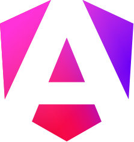

<p align="center"></p>

# @webship.co/workspace-angular

Angular for the [Webship Workspace](https://github.com/webship/workspace) dashboard: a builder that makes an Angular
app with the Angular CLI (or takes one from its repository), builds it and serves it from a container of its own, the
[Angular step pack](https://github.com/webship/angular-steps) wired into the testing setup of that app, and its AI
items — two agents, a skill, a command and two prompts for building and testing Angular apps — each listed in the
workspace folder of its kind.

The app brings its own language in its own container. Node.js runs in the app's container, at the version of the
workspace rule (24); the app is made there with the Angular CLI (`ng new --ssr`, pinned to 22.3.0) from Angular's
official starter with server rendering, built there with its own build, and served:

- **with server rendering** by its own server (`node dist/<project>/server/server.mjs`), told the hosts it answers;
- **without it** (only files for the browser) by a static server that falls back to the app's single page
  (`serve -s`, pinned to 14.2.8), so the app's router answers every address.

Nothing of Node.js, npm or the CLI runs on the machine. The app is the official starter with the demo pages of the
Angular step pack, the starter alone, or an app of your own from its repository.

The workspace is container-based (DDEV by default): an app is a row like any other, so the row menus the core draws
(start, stop, launch, backup, clone, remove, tests) work on it; what does not apply to an app without a database is
listed under [What is different from a platform](#what-is-different-from-a-platform). The builder builds on DDEV by
default, and with `--runtime` on Docker Compose, Podman or a Kubernetes cluster: see [Runtimes](#runtimes).

## Use it

```bash
cd ~/workspace
bash core/scripts/plugins.sh --require angular --with-needs     # npm install into the dashboard
bash core/scripts/plugins.sh --activate angular --with-needs    # plugins.angular in settings.yml
bash core/scripts/plugins.sh --install angular                  # the builder, functions, args, AI items
bash core/scripts/plugins.sh --configure angular                # nothing to configure: it has no settings file
```

The same four steps are buttons on the dashboard's **Settings → Plugins** page. `--install` is idempotent.
`--uninstall` removes what it placed; an AI item you edited stays.

Everything the plugin carries lands in the folder it belongs to, when that folder is an active workspace folder:

| What | Lands in |
| --- | --- |
| `cmd-angular-project.sh` | every active sites folder: `dev/`, `test/`, `sandboxes/`, `demos/` |
| The agents `angular-app-builder`, `angular-tester` | `ai-agents/` |
| The skill `angular-scenarios` | `ai-skills/` |
| The command `/angular-test` | `ai-commands/` |
| The prompts `angular-build-and-test`, `angular-scenarios-for-an-app` | `ai-prompts/` |

There they are listed like any other item of the folder, and installed into Claude Code from there.

## What it needs

A workspace starts empty, so the manifest says what else this plugin needs (`needs`):

- one sites folder, for the builder: `dev`, `test`, `sandboxes`, `demos` (`dev` is the one added when none is there). The folder also carries `cmd-tools-testing.sh` and the Users tools this plugin's hooks answer to.
- `ai-agents`, `ai-skills`, `ai-commands` and `ai-prompts`: the AI folders its agents, its skill, its command and its prompts are placed in.

`--require` says so, `--activate` and `--install` stop until the workspace has them, and `--with-needs` adds what is
missing first:

```bash
bash core/scripts/plugins.sh --activate angular --with-needs   # dev and the four AI folders are required, activated and installed first
bash core/scripts/plugins.sh --install angular
```

Everything the builder runs for an app runs in the app's own container, through the container tool the workspace
already needs; the plugin asks for no command of its own on the machine. Making an app downloads the Angular CLI, the
demo pages, the app's packages and, for an app without server rendering, the static server from the npm registry, in
the container.

## What the package holds

| Path | What it is |
| --- | --- |
| `commands/cmd-angular-project.sh` | The builder, in the Build list as **Angular (Angular app)**, installed into every sites folder |
| `scripts/functions/fun-angular.sh` | The bash functions behind it, sourced by bootstrap once installed; the names the core's tools look for (`set_angular_users`, `add_angular_users`, `cancel_angular_users`, `testing_configure_angular`) |
| `scripts/args/arg-angular.sh` | Its argparse; the Build form draws the builder's flags from it |
| `testing/site.feature` | The first feature the demo template gets when testing is set up |
| `ai/agents/angular-app-builder.md` | The agent that builds and fixes apps: the build in the container, the hosts the server answers, names a person reads, a title for each route |
| `ai/agents/angular-tester.md` | The agent that writes and runs scenarios with the step pack, with JavaScript and without |
| `ai/skills/angular-scenarios/` | The skill: the step pack's phrases, the traps found on a real app, three example features |
| `ai/commands/angular-test.md` | The slash command `/angular-test <app>`: set up when missing, match every step, run, report |
| `ai/prompts/angular-build-and-test.md`, `angular-scenarios-for-an-app.md` | Two prompts: whole launch commands for a new session |
| `src/index.ts` | `register(api)`: what the assistant is told about Angular here |
| `features/angular.feature`, `features/angular-runtimes.feature` | Scenarios for the dashboard's own browser suite |

The `workspacePlugin` block in `package.json` is the manifest the installer reads.

## What is different from a platform

| | WordPress (a platform) | Angular |
| --- | --- | --- |
| What is built | A WordPress site | An Angular app: the official starter with server rendering and the step pack's demo pages, the starter alone, or an app from its repository |
| Project | `--project-type=wordpress` | `--project-type=generic --webserver-type=generic`, no database: the app's own server, or the static server, serves it |
| The language | PHP, in the container tool's image | Node.js 24 in the app's container: DDEV's web container (`--nodejs-version`) on DDEV; on Docker Compose, Podman and Kubernetes the core's language stack (`rt_stack node 24`, Node.js's own image, and `rt_serve`) |
| Recognised by | The project type | On DDEV a file the builder writes, `.ddev/config.angular.yaml` (it also records where the app came from); on another runtime its claim, `platform: angular` in the `x-webship` block of `compose.yaml` |
| Accounts | WP-CLI | None of the workspace's: `--add-users` is taken and adds nothing |
| Testing | The WordPress pack | The Angular pack, which waits for the app to take each page over, follows the router to the end of each navigation and sends a form the way the app does |

## The commands

Run it from a sites folder. `--help` is safe.

### Build and serve an app

```bash
cd ~/workspace/dev
bash cmd-angular-project.sh ngapp --install                      # a new app: the starter with the demo pages
bash cmd-angular-project.sh ngmin --install --template minimal   # the official starter alone: one welcome page
bash cmd-angular-project.sh ngown --install --source https://github.com/<you>/<app>.git --ref main
bash cmd-angular-project.sh ngapp --install --runtime docker     # on Docker Compose instead of DDEV
bash cmd-angular-project.sh ngapp --install --runtime kubernetes # on the workspace's Kubernetes cluster
```

| Flag | What it does |
| --- | --- |
| `--install` | Serve the built app and check that it answers at its address (`https://<name>.ddev.site` on DDEV) |
| `--runtime ddev\|docker\|podman\|kubernetes` | The container runtime to build on (default: DDEV, or `container.runtime` of `settings.yml`); see [Runtimes](#runtimes) |
| `--template demo\|minimal` | The template a new app is made from (default: `demo`, the official starter with the step pack's demo pages; `minimal`, the starter alone) |
| `--source <git url>` | A repository of an Angular app, instead of a new one |
| `--ref <branch or tag>` | A branch or a tag of that repository (default: its default branch) |
| `--path <folder>` | The folder of the app in that repository, for a repository of several apps |
| `--add-users` | Taken so that every builder accepts the same flags; the app has no accounts of the workspace's |
| `--launch` | Open the app in a browser when it is ready |

The builder deletes a project of the same name first, then makes a container with Node.js, makes the app in it with
`ng new demo --ssr` (or copies it from its repository), installs its packages, builds it with its own build script, and
writes the script that serves the build (`.webship-angular/serve.sh`), which the app's container runs once it is
there. With `--install` it checks that the app answers.

**The demo template** is the official starter with server rendering, with the pages of the step pack's `demo/` over
it, taken from the pack's npm package at the release the builder pins (`@webship-js/angular-steps` 2.0.1): the demo the
builder makes is the one that release's features were proven on. It has a counter, an about page, posts from the
demo's API, a post by a resolver (404 for a missing one), a guard that redirects to the latest post, a contact form
that works without JavaScript and is sent in place with it, a page rendered in the browser alone, and a 404 page for an
address it does not know.

**The minimal template** is Angular's official starter with server rendering alone: one welcome page, prerendered when
the app is built.

**Which build each kind of app gets.** The builder reads the app's `angular.json` and what its build left:

| The app | Its build | What serves it |
| --- | --- | --- |
| With server rendering (`@angular/ssr`, as `ng new --ssr` makes it) | `dist/<project>/server/server.mjs` and the files for the browser | The app's own server: `node dist/<project>/server/server.mjs`, with `PORT` and `NG_ALLOWED_HOSTS` |
| Without it (a plain `ng new`) | `dist/<project>/browser/` (or `dist/<project>/` for an older build) | A static server that falls back to the app's single page: `serve -s`, pinned to 14.2.8, installed in `.webship-angular/serve/` |

An app of your own must be an Angular app whose packages are its own:

- **Its package manager** is read from its lock file: npm (`package-lock.json`, or none), pnpm or yarn, the last two
  through Node.js's corepack. One installed with Bun is refused, with a message.
- **Its build** must leave a server or files for the browser where its `angular.json` says; a build that leaves neither
  stops with a message.
- **Refused, with a message:** an app that takes packages of a workspace of its repository (`"workspace:"` in its
  `package.json`), and one that is not an Angular app (no `@angular/core`, or no `angular.json`).

The project's folder holds the app's source in `app/`, its build in `app/dist/`, and the builder's serve script (and
the static server, when the app needs it) in `.webship-angular/`. After a change to the app, build it again in the
container and restart the project, so its server loads the new build:

```bash
cd ~/workspace/dev/ngapp
ddev exec -d /var/www/html/app "npm run build"
ddev restart
```

### The address Angular's server answers

Angular's server answers only the hosts it is told about, and any other with 400 ("Header host with value … is not
allowed"): its guard against server-side request forgery. The builder tells the app's server the host of the project's
address, as the runtime says it (`NG_ALLOWED_HOSTS`): `<name>.ddev.site` on DDEV, the node's address on Kubernetes,
and `127.0.0.1` and `localhost` everywhere (the address on Docker Compose and Podman, and a check from inside the
container). Open the app at that address.

### Requests the app makes on the server

On the server, a page's request to the app's own API with a relative address goes to the address the browser used. A
server in a container may not reach that address from inside (a port of the machine, or the proxy in front of it), and
the page is drawn without its data. The demo template's pages send those requests to the server's own port instead (an
interceptor of the demo's own, `src/app/app.config.ts`); an app of your own that draws data from its own API on the
server needs the same.

### Test an app

```bash
bash cmd-tools-testing.sh ngapp                                  # webship-js, the step pack, a first feature
bash cmd-tools-testing.sh ngapp --run --path tests/features/site.feature
```

The testing setup adds `@webship-js/angular-steps` to the project, lists its step definitions in `cucumber.js`, and,
for the demo template, writes `tests/features/site.feature`. An app of your own gets no first feature: it has its own
names. It changes nothing in a project that is not an app of this builder.

The steps wait for the app to take each page over (hydration), follow the router to the end of each navigation (the
address committed, the app idle), and send a form either way: in place with JavaScript, with a page load without it.
Fill in fields after `And the page is hydrated`: when the app takes the page over, its form writes its own values into
its fields, and what was typed before is lost.

```gherkin
Feature: The contact form
  Scenario: A message too short is refused, and says why
    Given I am on "/contact"
    And the page is hydrated
    When I fill in "Your name" with "Ada"
    And I fill in "Your message" with "Too short"
    And I send the form by its "Send" button
    Then the form should have been refused with "Your message needs at least 10 characters."
```

### Runtimes

The commands are the same on every runtime: the builder speaks DDEV's verbs, and on another runtime the core's layer
(Webship Workspace 1.0.32 or later, webship/workspace#694 and #841) gives each verb its meaning there: the language
stack builds the web image from Node.js's own image at version 24 and starts the app's server in it. The app has no
database, so on Kubernetes it needs core 1.0.35 or newer (webship/workspace#884).

| Runtime | The address of the app | Proven with this builder |
| --- | --- | --- |
| DDEV (the default) | `https://<name>.ddev.site` | The demo template built and served in 1 min 2 s (Node.js 24 in DDEV's web container: the Angular CLI, the demo pages of `@webship-js/angular-steps` from npm, the packages and the build), taken over in 157 ms; a change of view by the router, the contact form answered in place and, without JavaScript, through the server; the posts drawn on the server (its requests to its own API at its own port); `NG_ALLOWED_HOSTS` with the project's host, and another host answered 400 inside the container; the testing setup from npm (`@webship-js/angular-steps`, webship-js 2.0.18) and its first feature, 5 scenarios and 22 steps |
| Docker Compose (`--runtime docker`) | `http://127.0.0.1:<port>`, a free port kept in `compose.yaml` | The demo template (`ci-angular`, the CI's featuresSite) built in 51 s, taken over in 315 ms, the same checks, another host answered 400; the testing setup and its first feature (5 scenarios, 22 steps), and the skill's three examples, each on its app: the demo's views (5 scenarios, 24 steps) and its contact form (3 scenarios, 20 steps), and the starter alone built with `--template minimal` in 53 s (3 scenarios, 9 steps; the 404 its server answers for an unknown address among them); an app without server rendering from its repository, the Jira clone (`--source https://github.com/trungvose/jira-clone-angular.git`: Angular 20.3, npm), built in 1 min 9 s and served by `serve -s`: a deep address loaded straight is answered with the app's single page, and the app starts there; the plugin's features on the dashboard |
| Podman (`--runtime podman`) | `http://127.0.0.1:<port>` | The demo template built in 1 min 12 s with Node.js's own image, taken over in 538 ms, the same checks, another host answered 400; the testing setup and its first feature (5 scenarios, 22 steps); the plugin's features on the dashboard |
| Kubernetes (`--runtime kubernetes`) | `http://<node address>:<NodePort>` | On kind (Kubernetes 1.37.0): the demo template built in 1 min 18 s, served at the node's address (the node's host among the allowed hosts), taken over in 69 ms, the same checks, another host answered 400; the testing setup on the cluster and its first feature (5 scenarios, 22 steps); the plugin's features on the dashboard, 12 scenarios with the Docker Compose, Podman and Kubernetes apps up |

A project of the builder is known by DDEV's file on DDEV and by its claim on another runtime, so the testing setup,
the Users tools (which say there are no accounts) and the dashboard's row work the same on each. Lando and Docksal are
runtimes of the workspace too, not proven with this builder yet: it says so and stops, before anything is made.

### Users

The app has no accounts of the workspace's. `cmd-tools-add-users.sh <name> angular` and
`cmd-tools-cancel-users.sh <name> angular` say so and change nothing.

## The AI items

| Item | Kind | What it is for |
| --- | --- | --- |
| `angular-app-builder` | agent | Builds and fixes Angular apps in their container: the build, the hosts the server answers, names a person reads, a title for each route, forms that work without JavaScript |
| `angular-tester` | agent | Writes and runs scenarios with the step pack: looks at the pages in the browser first, never sleeps, never names a framework or platform in a step, runs with JavaScript and without |
| `angular-scenarios` | skill | The step pack's phrases, the traps found on a real app, three example features that pass on the demo template and on the starter alone |
| `/angular-test <app>` | command | Sets the pack up when missing, matches every step, runs, reports |
| `angular-build-and-test` | prompt | Builds an app and proves it with its first feature |
| `angular-scenarios-for-an-app` | prompt | Writes and runs the scenarios of one page of an app of the workspace |

Every item says the workspace is container-based (DDEV by default), and the agents and the skill send the reader to
the book *Automated Functional Testing Recipes* first.

## Develop it

```bash
npm install
npm test        # builds, then the unit tests: the manifest, the scripts, the AI items, the needs
npm run lint    # the TypeScript compiler, no output
```

CI runs the same on Node.js 24 and 26, checks that every shell script parses, and runs the plugin's webship-js
features against a dashboard with the plugin installed (the reusable workflow
`webship/workspace/.github/workflows/plugin-browser-suite.yml`). Before the features it builds the app the manifest
names (`featuresSite`: `cmd-angular-project.sh ci-angular --install --runtime docker`), so the scenarios of
`features/angular-runtimes.feature` tagged `@needs-runtime-docker` drive a real app on Docker Compose; the Podman and
Kubernetes ones run where such an app is.
`tests/fixtures/step-definitions.txt` holds the step definitions of the step pack at the version the testing hook pins
and of webship-js, read from their packages: every phrase an AI item shows must match one of them.

## License

ISC (see `LICENSE`).

## Logo

The Angular logo is the Angular team's, from github.com/angular/angular, under CC BY 4.0
(https://creativecommons.org/licenses/by/4.0/), as Angular's press kit provides it. It is not covered by this
package's ISC licence.
